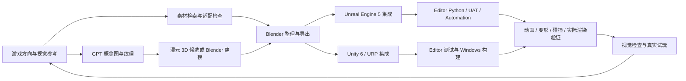

# AI 游戏工作室工作台 · Unity / Unreal Engine 5

把游戏设计、美术、素材、建模、Unity / UE5 集成和 Windows 验证接在一起的开发工作链。来自已经在本机配置、运行过的 **AIStudio** 独立验证工程。

**UE5 接入使用说明：[Unity / Unreal 共用工作台](Docs/Unreal.md)。** 通过 `Tools/Invoke-Workbench.ps1 -Engine Unity|Unreal` 选择引擎，两套工程独立，共用创作与素材来源管理。

UE **5.8.3** 已实际验证场景创建与独立进程读回、测试纹理导入、Windows 打包和打包程序启动/地图加载。UE 检查采用 NullRHI，GPU 画面和真人操作仍待验证。

图片主用 Codex 内置 GPT 图像生成；成熟素材合适时优先复用；原创模型经过 Blender 整理，再进入 Unity。ComfyUI 按需启用。

## 从哪里开始

1. 阅读 [工作链](Docs/Workflow.md) 和 [安装与使用](Docs/Setup.md)。
2. 安装 Unity、Unity CLI/Pipeline、Blender、Git LFS 和所需 Python 依赖。
3. 执行 `Tools/Initialize-Workstation.ps1` 生成本机配置，填写实际工具路径。
4. 自行准备有权使用的素材，运行 `Tools/Restore-LocalAssets.ps1`，登记 GPT 图片与 SHA-256。
5. 运行 `Start-AIStudio.cmd`、`Tools/Build-Studio.ps1`、`Tools/Run-WindowsQA.ps1`，检查新生成的报告和画面。

仓库提供工作台源码、配置模板和验证脚本。模型权重、Mixamo 原始动画、商店资源、生成模型、构建包和账号配置保留在本地。**新克隆需要准备素材后才能重建完整演示**；现有本机工作台不受此导出影响。

## 目录

| 目录 | 内容 |
|---|---|
| `Tools` | 启动/停止、构建、Windows QA、哈希、MCP、Blender、素材包检查 |
| `Project` | Unity 验证工程的脚本、测试、URP 设置和固定依赖 |
| `UnrealProject` | 独立 UE5 工程描述与配置；校准场景由脚本在本地生成 |
| `Adapters/Unreal` | UE 编辑器场景与资产任务 |
| `Config` | 图片策略、来源记录、本机配置样例和 GPT 提示词 |
| `Integrations/HybridAssets` | Fab 检索/导入、混元 3D、Blender 精修和素材准入工具 |
| `Docs` | 配置、完整流程、验证范围、公开仓库边界 |
| `EvidenceSnapshot` | 2026-10-14 本地已完成验证的脱敏摘要 |

## 已验证到什么程度

历史本机验证：Unity Editor 测试 **6/6** 通过；Windows 构建成功（0 错误、1 警告），动画、蒙皮变形、碰撞和 GPT 图片实际渲染通过；Blender 批处理、GLB 重新导入、Git LFS 本地传输与重新克隆通过。

这些是原本机 Unity 验证工程的结果，见 [验证记录](Docs/Validation.md)。UE5 有独立的验证记录，不能沿用 Unity 结果；本次没有重新进行 Unity 构建、真人键鼠试玩或性能验收。

## 公开与本地的边界

公开的是工具和流程。素材授权、地域范围、项目视觉质量和发布验收分别检查。`asset_gate.py` 会继续检查素材依赖和哈希；新仓库的素材登记表为空，不能借用历史结论批准新素材。

详细排除范围见 [发布说明](Docs/Publication.md)。软件版本记录的是当时跑通的组合，并不表示当前最新版本。
